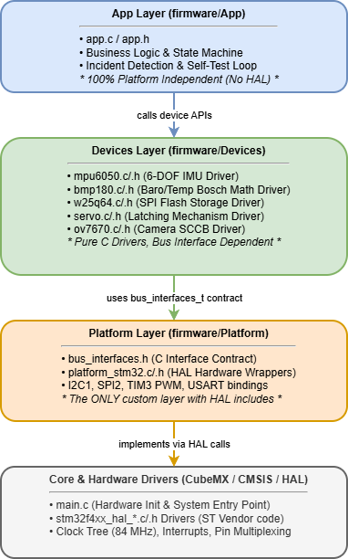

# Архітектура програмного забезпечення (Software Architecture)
## Мультирежимний реєстратор інцидентів (Incident Recorder: Black Box)

Відповідно до вимог п. 4.5 методичних вказівок, програмний комплекс реалізовано за строгою 4-рівневою шаруватою архітектурою (Layered Architecture) із забезпеченням принципу інверсії залежностей (Dependency Inversion Principle).

---

### 1. Рівні системи та правила ізоляції

1. **App Layer (`firmware/App/`):**
   * **Призначення:** Високорівнева бізнес-логіка автономного реєстратора інцидентів: проведення самодіагностики при старті (Self-Test), періодичне опитування сенсорів, моніторинг тригерів ударного перевантаження ($\vert{}a\vert{} > 2.5g$) та кутів нахилу, аварійне блокування контейнера сервоприводом.
   * **Правило ізоляції:** Повністю платформонезалежний код. Взаємодіє з периферією виключно через API шару драйверів `Devices`. Не містить прямих звернень до мікроконтролера, регістрів та вендорських бібліотек HAL.

2. **Devices Layer (`firmware/Devices/`):**
   * **Призначення:** Апаратно-незалежні драйвери зовнішніх сенсорів та виконавчих пристроїв:
     * `mpu6050.c/.h` — інерційний 6-осьовий сенсор (акселерометр + гіроскоп);
     * `bmp180.c/.h` — барометричний датчик тиску та температури з алгоритмом компенсації Bosch;
     * `w25q64.c/.h` — енергонезалежна Flash-пам'ять 64 Мбіт (JEDEC ID, блокове стирання, запис сторінок);
     * `servo.c/.h` — виконавчий механізм блокування засува контейнера;
     * `ov7670.c/.h` — модуль фотофіксації (SCCB ідентифікація).
   * **Правило ізоляції:** Жоден драйвер не включає `stm32f4xx_hal.h`. Доступ до шин I2C, SPI, SCCB, PWM здійснюється через універсальні контрактні структури покажчиків на функції з `bus_interfaces.h`. Драйвери можуть компілюватися як під цільову платформу ARM, так і під хост-систему x86-64 для юніт-тестів.

3. **Platform Layer (`firmware/Platform/`):**
   * **Призначення:** Адаптація абстрактних інтерфейсів шин (`bus_interfaces.h`) до апаратних периферійних блоків плати STM32 NUCLEO-F411RE (`I2C1`, `SPI2`, `TIM3_CH1`, `USART1/2`).
   * **Правило ізоляції:** Єдиний авторський шар системи, де дозволено включення `main.h` та прямі виклики функцій вендорської бібліотеки HAL.

4. **Core & Drivers Layer (`firmware/Core/`, `firmware/Drivers/`):**
   * **Призначення:** Низькорівневий апаратний каркас, згенерований STM32CubeMX: CMSIS, таблиця векторів переривань, стартап-код, налаштування системного тактування PLL 84 МГц та драйвери HAL.

---

### 2. Діаграма компонентів (Component Diagram)

  

---

### 3. Автоматична верифікація правил залежностей

Для запобігання випадковому порушенню архітектурних меж розроблено валідатор `scripts/check_deps.py`. Скрипт автоматично перевіряє вихідний код шарів `Devices/` та `App/` на наявність заборонених включень (`stm32f4xx_hal.h`, `main.h`, префіксів `HAL_`). Скрипт інтегровано в Makefile (`make check-deps`) та в конвеєр CI.