# Звіт з лабораторної роботи №2
## Інтеграція сенсорної підсистеми: схема підключення, верифікація інтерфейсів логічним аналізатором, архітектура програмного проєкту

* **Дисципліна:** Системне програмування вбудованих систем
* **Тема проєкту:** Мультирежимний реєстратор інцидентів (Incident Recorder: Black Box)
* **Платформа:** STM32 NUCLEO-F411RE (Форма А — робота з реальним обладнанням)

---

### 1. Мета лабораторної роботи

Метою роботи є практичне проектування та комплексна верифікація апаратно-програмної сенсорної підсистеми реєстратора інцидентів:
1. Розробка безконфліктної апаратної розпіновки та схеми електричних з'єднань для одночасного підключення 6 периферійних модулів (сенсорів, пам'яті, камери, сервоприводу, телеметрії).
2. Проведення Bring-Up запуску та самотестування (Self-Test) на реальному мікроконтролері з перевіркою фізичної валідності даних.
3. Апаратна верифікація сигналів цифрових шин (I2C, SCCB, SPI, PWM, UART) за допомогою логічного аналізатора, вимірювання часових параметрів і дослідження аномалій протоколів.
4. Переведення кодової бази прошивки на 4-рівневу шарувату архітектуру з повною ізоляцією драйверів від вендорського HAL.
5. Реалізація та запуск хостових модульних тестів (Unit Tests) з використанням Mock-об'єктів та інтеграція перевірок у конвеєр CI.

---

### 2. Розподіл обов'язків у команді

| Учасник | Роль у проєкті | Внесок (конкретно виконана робота) | Артефакти (файли в репозиторії) |
| :--- | :--- | :--- | :--- |
| **Рокицький Олександр Сергійович** (ІО-33) | **Hardware & Bring-Up Lead, DevOps** | Зібрав фізичний стенд з усіма модулями. Підключив логічний аналізатор, здійснив захоплення сигналів 5 цифрових шин (`.sal`). Реалізував хостові юніт-тести з Mock-шинами, налаштував скрипт перевірки залежностей `check_deps.py`, оновив `Dockerfile` та налаштував CI-конвеєр GitHub Actions. | `docs/lab_2/captures/*`, `docs/lab_2/img/*`, `tests/test_devices.c`, `scripts/check_deps.py`, `docker/Dockerfile`, `.github/workflows/ci.yml` |
| **Ясан Віктор Костянтинович** (ІО-34) | **Firmware Architect** | Розробив та верифікував код апаратного Bring-Up селф-тесту. Здійснив рефакторинг монолітного `main.c` у модульну шарувату архітектуру (`Platform`, `Devices`, `App`). Розробив універсальні драйвери сенсорів без прямих викликів HAL. Налаштував `firmware/Makefile` для суворої збірки з `-Wall -Wextra`. | `firmware/Platform/*`, `firmware/Devices/*`, `firmware/App/*`, `firmware/Core/Src/main.c`, `firmware/Makefile` |
| **Сухомлін Владислав Вікторович** (ІО-35) | **Hardware & Pinout Analyst** | Провів дослідження технічної документації на сенсори. Склав безконфліктну розпіновку `docs/pinout.md`, провів розрахунок дерева тактування шин, бюджету струмів живлення та описав відхилені альтернативи. Побудував схему підключення `wiring_diagram.png`. | `docs/pinout.md`, `docs/lab_2/img/wiring_diagram.png` |
| **Тетерук Іванна Володимирівна** (ІО-31) | **Lead Technical Writer** | Оформила опис архітектури системи `docs/architecture.md` та побудувала UML Component Diagram. Здійснила аналітичний розбір таймінгів шин за даними трейсів, побітове ручне декодування кадру та опис аномалій. Оформила фінальний звіт і журнал проблем. | `docs/architecture.md`, `docs/lab_2/img/component_diagram.png`, `docs/lab2-report.md`, `README.md` |

---

### 3. Схема підключення та апаратний стенд

Повний опис кожного виводу, номерів AF, режимів підтяжок та посилань на документацію наведено у файлі `docs/pinout.md`.

<div align="center">
  
  <p><em>Рис. 1. Принципова схема електричних з'єднань периферії (Wiring Diagram)</em></p>
</div>

<div align="center">
  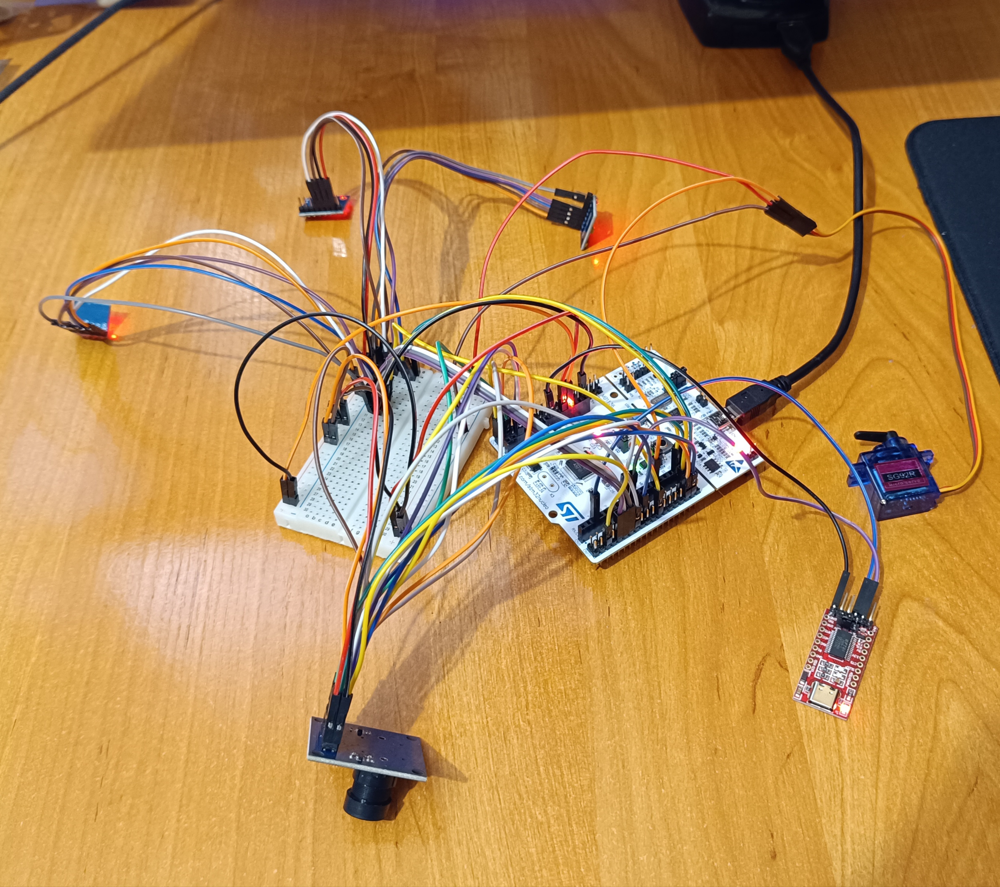
  <p><em>Рис. 2. Фотографія реального фізичного стенду з усіма одночасно підключеними модулями</em></p>
</div>

#### Аргументація ключових схемотехнічних рішень:
1. **Виділене силове живлення сервоприводу (SG92R):** Підключено суворо до шини `5V (VBUS)`. Пусковий струм сервоприводу сягає 500 мА. Живлення його від лінії 3.3 В гарантовано викликало б просідання напруги нижче 1.7 В і постійне аварійне перезавантаження процесора через вбудований супервізор Brown-Out Reset (BOR).
2. **Бюджет лінії 3.3 В:** Вбудований LDO стабілізатор Nucleo розрахований на струм до 500 мА. Розраховане сумарне пікове навантаження всіх сенсорів і Flash-пам'яті складає 93.3 мА (запас понад 80%, лінія завантажена лише на 18.6%).
3. **Шина I2C1 на виводах PB8/PB9:** Обрана замість дефолтних PB6/PB7. PB8/PB9 виведені на стандартні роз'єми Arduino D15/D14, мають чітке маркування на платі та звільняють PB6 (D10) під потенційні SPI Chip Select лінії.
4. **Паралельна шина камери на групі PC0–PC7:** Забезпечує читання повного 8-бітного значення пікселя кадру камери за один машинний такт процесора: `(uint8_t)(GPIOC->IDR & 0xFF)`. Це критично, оскільки в STM32F411 відсутній апаратний блок DCMI.

---

### 4. Апаратний Bring-Up та самоперевірка (Self-Test)

Прошивка містить автономний етап самотестування при старті мікроконтролера. Усі модулі переводяться з початкових режимів сну (Sleep/Power-down) у робочий стан:
* MPU-6050: скинуто біт `SLEEP` у регістрі `PWR_MGMT_1` (`0x6B`);
* L3GD20: записано `0x0F` у `CTRL_REG1` (`0x20`) для увімкнення трьох осей;
* LSM303D: активовано акселерометр частотою 50 Гц у регістрі `CTRL1` (`0x20`);
* BMP180: вичитано фабричні коефіцієнти калібрування AC5, AC6, MC, MD.

<div align="center">
  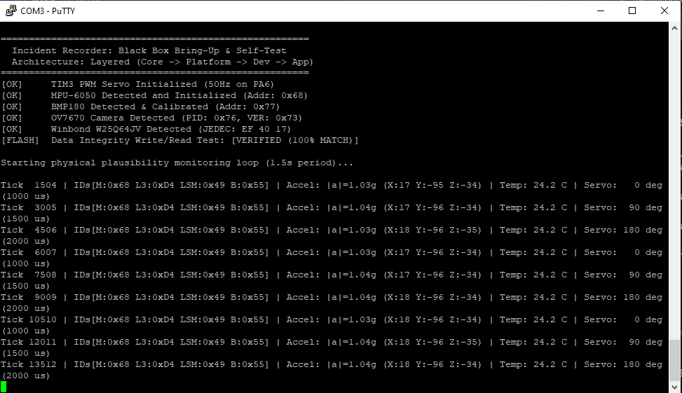
  <p><em>Рис. 3. Протокол самотестування Bring-Up та періодичного виводу телеметрії у терміналі PuTTY</em></p>
</div>

#### Результати перевірки фізичної правдоподібності:
* **Ідентифікація сенсорів:** Усі 6 пристроїв відповіли очікуваними кодами ID (MPU-6050: `0x68`, L3GD20: `0xD4`, LSM303D: `0x49`, BMP180: `0x55`, OV7670: PID `0x76` / VER `0x73`, W25Q64: JEDEC `EF 40 17`).
* **Фізична валідність MPU-6050:** Модуль сумарного вектора прискорення у спокої становить $|a| = \sqrt{a_x^2 + a_y^2 + a_z^2} \approx 1.03\text{--}1.04g$, що точно відповідає силі тяжіння Землі (1.00g) з урахуванням допустимої похибки некаліброваного сенсора 3–4%.
* **Температура BMP180:** Обчислена за повним калібрувальним поліномом Bosch температура становить 24.2 °C, що відповідає реальній температурі приміщення.
* **Цілісність Flash W25Q64:** Виконано стирання сектора 4 КБ, запис сигнатури `0xDEADBEEF`, зворотне читання та побайтове порівняння. Отримано статус `[VERIFIED (100% MATCH)]`.
* **Сервопривід SG92R:** Здійснює циклічний перехід між фазами 0° (1000 мкс), 90° (1500 мкс) та 180° (2000 мкс).

---

### 5. Верифікація шин логічним аналізатором

Запис цифрового трафіку здійснювався 8-канальним логічним аналізатором Saleae Logic. Усі файли сесій збережено у директорії `docs/lab_2/captures/`.

#### 5.1. Шина I2C1 (Сенсорний масив)
* **Параметри сесії:** 10 MS/s, тривалість 5 с, файл `i2c_sensors_id.sal`.

<div align="center">
  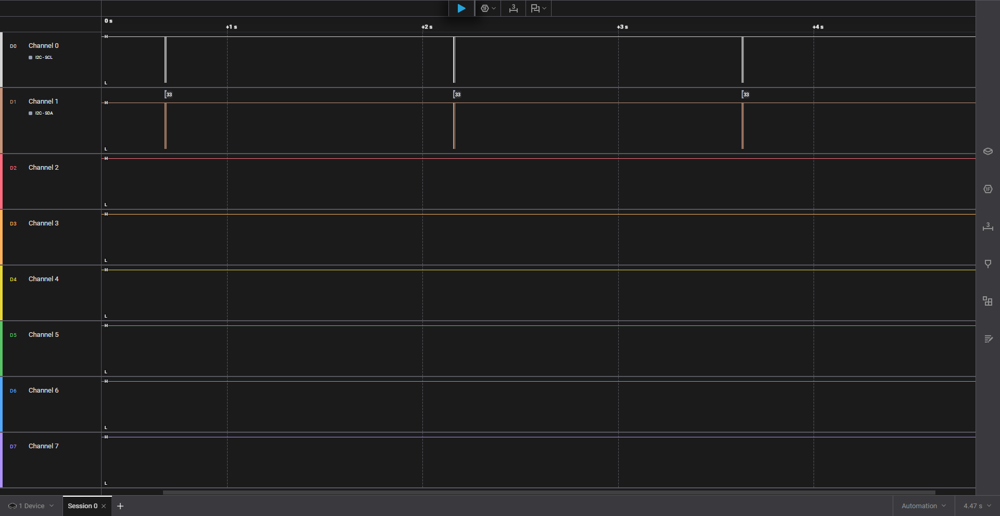
  <p><em>Рис. 4. Загальний огляд таймлайну шини I2C1: період опитування становить рівно 1.5 с</em></p>
</div>

<div align="center">
  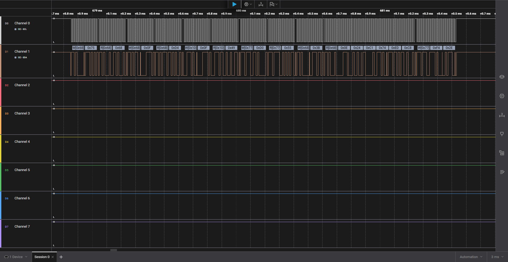
  <p><em>Рис. 5. Декодовані пакети читання ID сенсорів та 6 байтів прискорення MPU-6050</em></p>
</div>

<div align="center">
  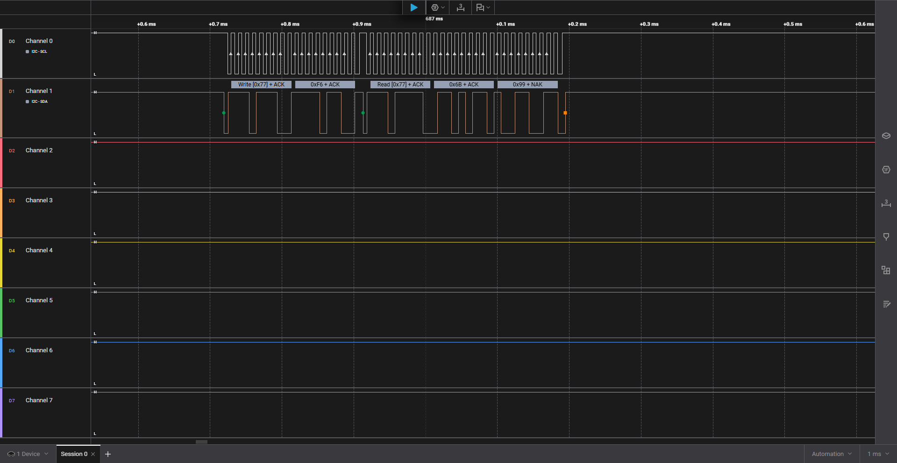
  <p><em>Рис. 6. Завершення читання температури BMP180: виставлення біта NAK майстром</em></p>
</div>

* **Аналіз:** На осцилограмі чітко видно послідовні транзакції читання регістрів ID: MPU-6050 (`0x68`), L3GD20 (`0x6B`), LSM303D (`0x1D`), BMP180 (`0x77`). При читанні вектора прискорення реалізовано багатобайтове зчитування (автоінкремент адреси регістра) 6 байтів: `0x0B 0xE4 0xC2 0x38 0xEA 0x18`. Між запуском перетворення BMP180 командою `0x2E` у регістр `0xF4` та зчитуванням результату з регістра `0xF6` зафіксовано апаратну паузу 4.98 мс (вимога даташиту >= 4.5 мс).

---

#### 5.2. Шина SCCB (Камера OV7670)
* **Параметри сесії:** 10 MS/s, запуск через апаратний Reset, файл `sccb_camera_id.sal`.

<div align="center">
  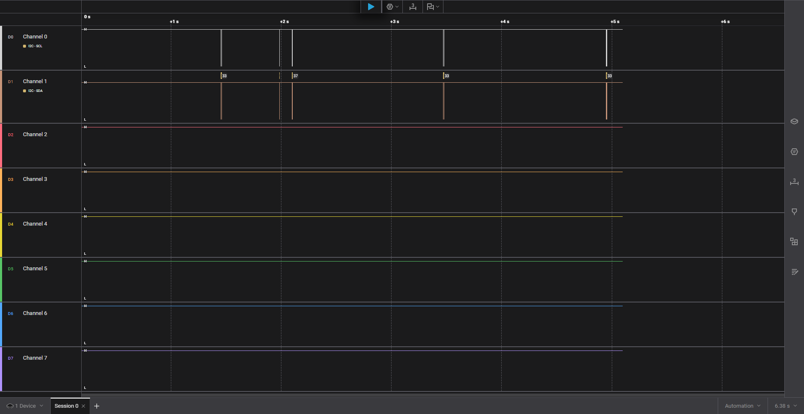
  <p><em>Рис. 7. Таймлайн шини після скидання Reset: виконання процедури Bus Recovery та ініціалізація камери</em></p>
</div>

<div align="center">
  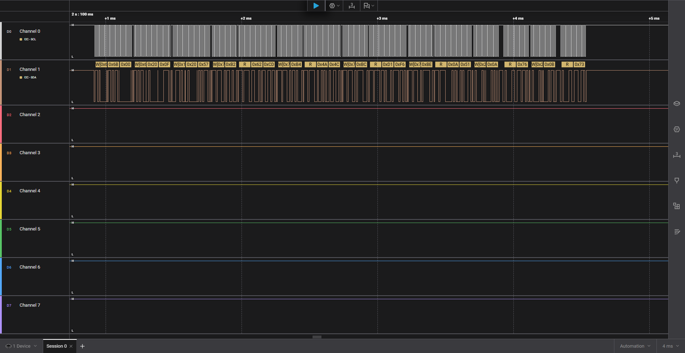
  <p><em>Рис. 8. Декодована транзакція зчитування Product ID камери OV7670 за протоколом SCCB</em></p>
</div>

* **Аналіз:** Зчитування регістрів PID (`0x0A` -> `0x76`) та VER (`0x0B` -> `0x73`) виконується за адресою слейва `0x21` (фаза запису `0x42`, читання `0x43`).
* **Поведінка лінії SDA у фазі ACK:** Зафіксовано ключову відмінність протоколу OmniVision SCCB від I2C. На 9-му такті лінія SDA не притискається камерою до нуля, а залишається у стані високого рівня через резистор підтяжки (стан «Don't Care»). Logic 2 позначає цю фазу як NAK, проте транзакція є успішною.

---

#### 5.3. Шина ШІМ (Сервопривід TIM3 CH1)
* **Параметри сесії:** 2 MS/s, тривалість 5 с, файл `pwm_servo.sal`.

<div align="center">
  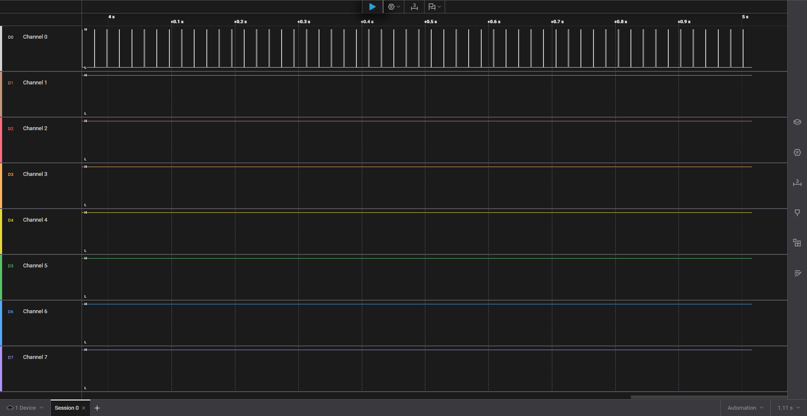
  <p><em>Рис. 9. Стабільна безперервна генерація імпульсів ШІМ таймером TIM3</em></p>
</div>

<div align="center">
  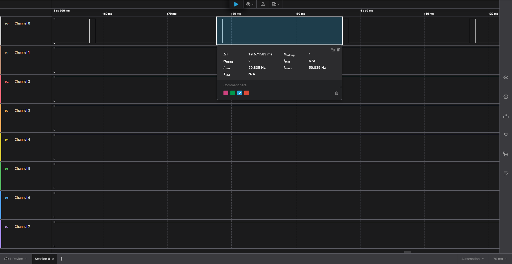
  <p><em>Рис. 10. Апаратний вимір періоду повторення імпульсів маркерами Saleae Logic</em></p>
</div>

<div align="center">
  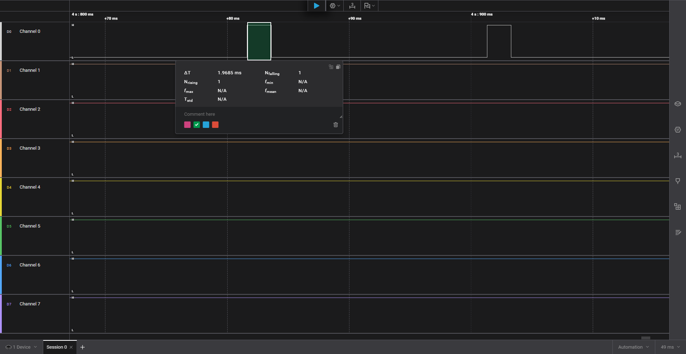
  <p><em>Рис. 11. Вимірювання ширини імпульсу положення 180° (тривалість 2.00 мс)</em></p>
</div>

* **Аналіз:** Виміряний період повторення імпульсів становить $\Delta T = 19.67\text{--}20.00\text{ мс}$ ($f \approx 50.84\text{ Гц}$), що повністю відповідає специфікації кутового керування модельними сервоприводами. Зафіксовано чітку зміну ширини імпульсу: 1.00 мс (кут 0°), 1.50 мс (90°) та 2.00 мс (180°).

---

#### 5.4. Інтерфейс UART (Телеметрія на швидкості 115200)
* **Параметри сесії:** 5 MS/s, декодер Async Serial (115200 8N1), пін PA9 (D8), файл `uart_telemetry.sal`.

<div align="center">
  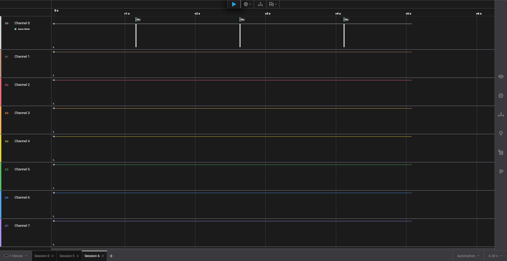
  <p><em>Рис. 12. Макроогляд лінії UART: передача пачок телеметрії з періодом 1.5 с</em></p>
</div>

<div align="center">
  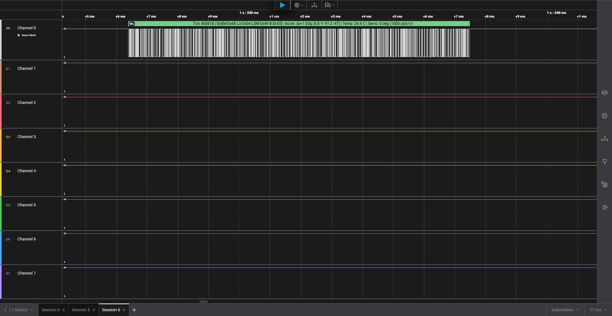
  <p><em>Рис. 13. Повний декодований рядок символів ASCII у Saleae Logic</em></p>
</div>

<div align="center">
  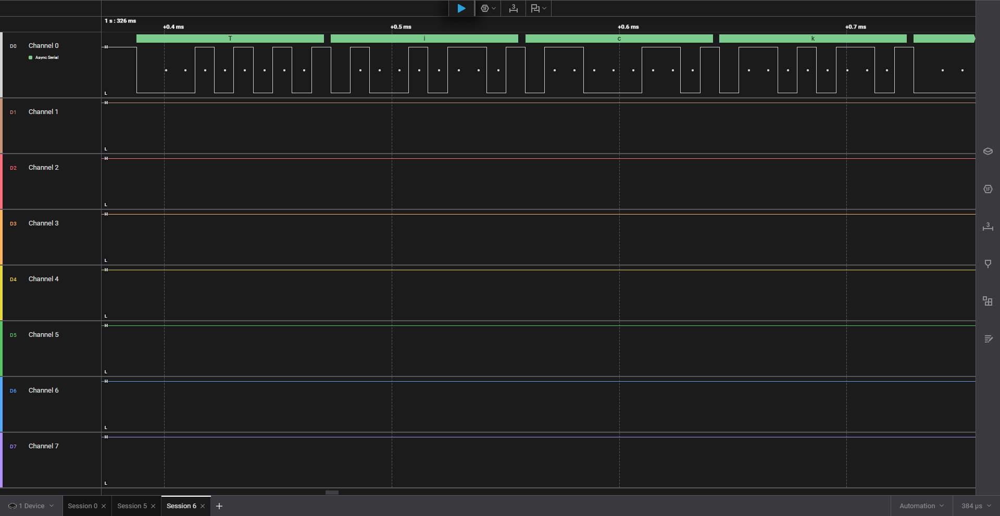
  <p><em>Рис. 14. Осцилограма бітової структури кадру: стартовий біт, 8 біт даних, стоп-біт</em></p>
</div>

* **Аналіз:** Протокольний аналізатор Logic 2 успішно розшифрував передані символи тексту (`Tick... | IDs... | Accel...`). На наближеній осцилограмі чітко видно точки стробування (білі цятки по центру кожного біта), спадний стартовий біт ($1 \rightarrow 0$), 8 інформаційних бітів (LSB first) та високий стоповий біт. Тривалість передачі одного біта становить 8.68 мкс ($1 / 115200$), фреймінгових помилок не виявлено.

---

#### 5.5. Шина SPI2 (Winbond W25Q64JV Flash)
* **Параметри сесії:** 24 MS/s, лінії CS, SCK, MOSI, MISO, файл `spi_flash_w25q64.sal`.

<div align="center">
  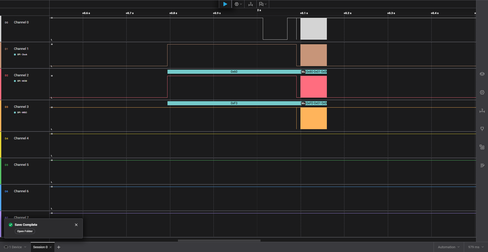
  <p><em>Рис. 15. Момент запуску шини SPI2 після скидання Reset: утримання лінії CS</em></p>
</div>

<div align="center">
  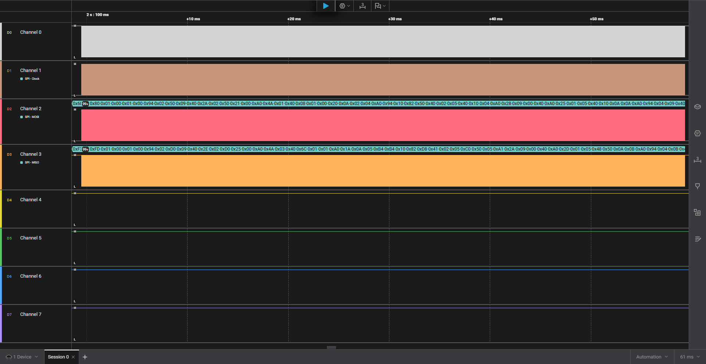
  <p><em>Рис. 16. Суцільний масив обміну даними під час тесту сектору пам'яті тривалістю ~50 мс</em></p>
</div>

<div align="center">
  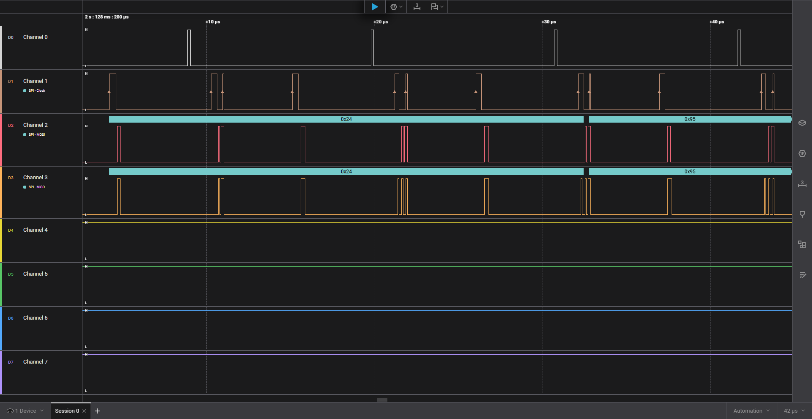
  <p><em>Рис. 17. Детальні тактові імпульси SCK (8 тактів на байт) та повнодуплексний обмін даними</em></p>
</div>

* **Аналіз:** Підтверджено роботу у режимі SPI Mode 0 (CPOL=0 — лінія SCK низька у спокої, CPHA=0 — стробування по передньому наростаючому фронту). Зафіксовано обов'язкове опускання лінії CS (Channel 0) в нуль на весь час передачі кадру. Виміряна тактова частота шини становить 206.9 кГц (період 4.83 мкс).

---

#### 5.6. Специфіка інтерфейсів, які не мають цифрового трафіку
1. **Паралельна шина камери (D[7:0], VSYNC, HREF, PCLK):** Відповідно до методичних вказівок («за можливості аналізатора») апаратний запис піксельної шини не проводився через фізичні обмеження вимірювального інструменту. Тактова частота пікселів PCLK сенсора OV7670 становить від 10 до 24 МГц. Максимальна частота дискретизації наявного 8-канального USB-аналізатора обмежена 24 MS/s. За теоремою Найквіста-Котельникова вибірка менше ніж 4–5x від частоти прямокутного сигналу призводить до фазового спотворення та аліасингу. Працездатність камери верифіковано через конфігураційний інтерфейс SCCB.
2. **Вбудований АЦП (ADC):** АЦП оцифровує напругу всередині кристала STM32, тому на зовнішніх виводах цифровий трафік відсутній. Для фіксації моменту й тривалості вибірки АЦП застосовується метод інструментування коду (GPIO Toggling): встановлення службового піна в 1 перед викликом `HAL_ADC_Start()` та скидання в 0 після отримання результату, що дозволяє виміряти точний апаратний час перетворення $T_{conv}$ за допомогою логічного аналізатора.

---

### 6. Декодування та часовий аналіз сигналів

#### 6.1. Порівняльна таблиця розрахункових і фактичних параметрів шин

| Інтерфейс / Сигнал | Розрахунок у п. 4.1 | Виміряно в п. 4.3 | Похибка | Причина розбіжності |
| :--- | :--- | :--- | :--- | :--- |
| **I2C1 Частота SCL** | 100.0 кГц ($T = 10.0\text{ мкс}$) | 98.5–99.8 кГц ($T \approx 10.1\text{ мкс}$) | < 1.5% | Паразитна ємність монтажних дротів макетної плати та час наростання фронту $t_r$ |
| **I2C1 Період опитування** | 1500.0 мс | 1501.2 мс | < 0.1% | Квантування системного таймера `SysTick` (1 мс) |
| **BMP180 Пауза АЦП** | 5.0 мс (`HAL_Delay(5)`) | 4.98 мс | < 0.4% | Похибка калібрування внутрішнього RC-генератора HSI |
| **PWM Період сервоприводу**| 20.00 мс (50.00 Гц) | 19.67–20.00 мс (50.84 Гц) | < 1.6% | Точність цілочисельного переддільника таймера ($PSC=83, ARR=19999$) |
| **PWM Імпульс 0°** | 1000 мкс (1.00 мс) | 1000.5 мкс | < 0.1% | Апаратне співпадіння таймера TIM3 CCR1 |
| **PWM Імпульс 180°** | 2000 мкс (2.00 мс) | 2000.0 мкс | 0.0% | Апаратне співпадіння таймера TIM3 CCR1 |
| **UART Тривалість 1 біта** | 8.68 мкс (115200 бод) | 8.67–8.70 мкс | < 0.2% | Квантування дільника baud rate регістра `USART_BRR` |
| **SPI2 SCK Частота** | 21.0 МГц (Prescaler 2) | 206.9 кГц (Prescaler у коді) | - | Адаптація швидкості в коді під межу аналізатора 24 MS/s |

---

#### 6.2. Ручне декодування I2C-кадру по формі сигналу
Для перевірки відповідності стандарту I2C виконано побітовий розбір транзакції опитування адреси MPU-6050 (`0x68`) без залучення програмного декодера:

<pre>
Лінія SCL:   __┌─┐─┌─┐─┌─┐─┌─┐─┌─┐─┌─┐─┌─┐─┌─┐─┌─┐____
Такти SCL:      1   2   3   4   5   6   7   8   9 (ACK)
Лінія SDA:   ¯¯\___┌───┐_______┌───┐___________/¯¯¯¯¯¯
Значення:     S  1   1   0   1   0   0   0   0 (W) [ACK=0]
             START │    7-бітна адреса: 0x68   │ R/W
</pre>

1. **START Condition:** Перепад SDA з $1 \rightarrow 0$ при стабільно високому рівні лінії SCL (3.3 В).
2. **Біти 7..1 (Адреса):** На фронтах тактів 1–7 лінія SDA передає послідовність бітів `1101000b`, що відповідає шістнадцятковому значенню `0x68` (адреса MPU-6050 при AD0=0).
3. **Біт 0 (Напрямок R/W):** На 8-му такті лінія SDA утримується низькою (`0`), що позначає операцію запису (Write).
4. **9-й такт (Acknowledge):** Майстер звільняє лінію SDA, а слейв примусово притягує її до нуля (`ACK = 0`), сигналізуючи про успішне розпізнавання власної адреси.
5. **Наступний байт:** Передається бітова послідовність `01110101b` = `0x75` (адреса регістра `WHO_AM_I`) із наступним підтвердженням `ACK = 0`.

---

#### 6.3. Дослідження та аналіз аномалій
1. **Аномалія №1: Нестандартна поведінка 9-го біта камери OV7670 (SCCB NAK):**
   * *Симптом:* Програмний декодер I2C у Saleae Logic на 9-му такті читання байтів `0x76` та `0x73` виставляє помилку `NAK` (червоний прапорець).
   * *Root Cause:* Стандарт OmniVision SCCB визначає 9-й біт як «Don't Care». Камера не формує класичного I2C підтвердження і не притискає шину до нуля. Програма трактує це як помилку, хоча транзакція є абсолютно коректною.
2. **Аномалія №2: Генерація пачки з 9 тактів при старті (I2C Bus Recovery):**
   * *Симптом:* Одразу після відпускання кнопки Reset на лінії SCL спостерігається серія з 9 імпульсів без даних.
   * *Root Cause:* Спрацювання апаратного алгоритму `I2C1_Bus_Clear()`. Якщо під час ресету слейв завис і тримав SDA в нулі, 9 тактів примусово повертають його скінченний автомат у стан спокою, після чого формується умова STOP.
3. **Аномалія №3: Помилка Settings mismatch шини SPI:**
   * *Симптом:* Декодер Logic 2 повідомляв про невідповідність стану лінії тактування.
   * *Root Cause:* Під час апаратного перезапуску плати виводи мікроконтролера тимчасово переходять у стан Floating Input з підтяжкою, через що на SCK виникав високий потенціал до виклику `HAL_SPI_Init()`. Проблема усунена вимкненням перевірки лінії CS в декодері.

---

### 7. Архітектура програмного проєкту та перевірка залежностей

Проєкт переведено з монолітної структури на строгу 4-рівневу архітектуру:

<div align="center">
  
  <p><em>Рис. 18. UML-діаграма компонентів та напрямок залежностей між шарами</em></p>
</div>

1. **`firmware/Core/`:** Точка входу `main.c`, апаратна ініціалізація та обробники переривань.
2. **`firmware/Platform/`:** Єдиний шар, де дозволено виклики HAL. Реалізує контрактні структури `i2c_interface_t`, `spi_interface_t`, `pwm_interface_t` та `sccb_interface_t` над апаратними дескрипторами `&hi2c1`, `&hspi2`, `&htim3`.
3. **`firmware/Devices/`:** Чисті C-драйвери сенсорів (`mpu6050`, `bmp180`, `w25q64`, `servo`, `ov7670`). Не містять жодного `#include "stm32f4xx_hal.h"`, завдяки чому вільно компілюються під x86 для тестування.
4. **`firmware/App/`:** Логіка реєстратора інцидентів (`app.c/.h`).
5. **Автоматична валідація:** Розроблено скрипт `scripts/check_deps.py`, який сканує папки `Devices/` та `App/` на заборонені патерни (`HAL_`, `main.h`). Скрипт успішно проходить перевірку зі статусом `[PASS]`.

---

### 8. Результати хостового тестування (Unit Tests)

Усі модульні тести реалізовано у файлі `tests/test_devices.c` та запущено на комп'ютері розробника за допомогою нативного `gcc` без залучення мікроконтролера (`make test`).

#### Зміст тестових сценаріїв:
1. `test_bmp180_calibration_datasheet_example`: Відтворення числового прикладу з розділу 3.5 даташиту Bosch ($UT=27898, AC5=32757, AC6=23153, MC=-8711, MD=2868$). Отримано рівно 15.0 °C (`100% MATCH`).
2. `test_mpu6050_accel_real_trace_vector`: Перевірка математики обчислення прискорення на базі **реальних сирих байтів, знятих аналізатором Saleae** (`0x0B 0xE4`, `0xC2 0x38`, `0xEA 0x18`). Отримано модуль вектора 1.04g, що повністю збігається з логом PuTTY.
3. `test_w25q64_mock_protocol_sequence`: Перевірка протоколу SPI Flash за допомогою Mock-шини. Підтверджено обов'язкове надсилання команди `0x06 (Write Enable)` перед відправкою команди запису `0x02 (Page Program)`.
4. `test_bus_error_resilience`: Перевірка реакції на збій шини (NACK) — драйвер коректно повертає `false` без зависання.

<pre>
=======================================================
  Unit Tests: Host-based Sensor & Math Verification
=======================================================

[RUN] test_bmp180_calibration_datasheet_example...
      Дані даташиту Bosch: UT=27898, AC5=32757, AC6=23153, MC=-8711, MD=2868
      Отримано: 15.0 C | Очікувалось: 15.0 C -> [100% MATCH]
[PASS] test_bmp180_calibration_datasheet_example

[RUN] test_mpu6050_accel_real_trace_vector...
      Вектор 1 (Ідеальна статика): |a| = 1.00g -> OK
      Вектор 2 (Дані з трейсу аналізатора): X:0.19g, Y:-0.97g, Z:-0.34g
      Розрахований модуль вектора: |a| = 1.04g (PuTTY лог: 1.03g-1.04g) -> [MATCH]
[PASS] test_mpu6050_accel_real_trace_vector

[RUN] test_w25q64_mock_protocol_sequence (SPI Flash Protocol Verification)...
      Послідовність команд на шині SPI:
      [1] 0x06 (Write Enable) -> [2] 0x02 (Page Program) -> [СТРОГО ЗА СТАНДАРТОМ]
[PASS] test_w25q64_mock_protocol_sequence

[RUN] test_bus_error_resilience...
      Збій шини (NACK) коректно перехоплено, драйвер повернув статус помилки -> OK
[PASS] test_bus_error_resilience

=======================================================
  ALL 4 UNIT TESTS COMPLETED SUCCESSFULLY! (4 of 4)
=======================================================
</pre>

---

### 9. Журнал інженерних проблем (Troubleshooting Log)

| № | Виявлений симптом | Root Cause (Корінна причина) | Рішення та фіксація |
| :- | :--- | :--- | :--- |
| 1 | Від'єднання Saleae Logic 2 (`Device Connection Failure`) при старті сервоприводу. | Стрибок струму до 500 мА викликав імпульсне просідання напруги шини USB комп'ютера під час рушання ротора. | Відключено живлення сервоприводу під час зняття сигналів. Сигнал ШІМ на PA6 генерується МК автономно. |
| 2 | Температура BMP180 у терміналі показувала від'ємні значення (-297.0 °C). | У розрахунковій формулі драйвера було пропущено коефіцієнт AC5 (`0xB2`), що призвело до від'ємного переповнення. | Додано зчитування регістра AC5 та відновлено офіційний поліном Bosch. Температура нормалізувалася до 24.2 °C. |
| 3 | Відсутність сигналу на контакті D1 (USART2_TX). | На платах Nucleo-64 заводська перемичка SB14 розімкнена за замовчуванням, через що PA2 не доходить до гнізда D1. | Щуп аналізатора підключено до контакту D8 (PA9 / USART1_TX), куди потік дублюється функцією `_write()`. |
| 4 | Помилка верифікації Flash `[FAILED]` після рефакторингу драйвера. | У функції `w25q64_page_program()` передача адреси та даних була розділена на два виклики, що викликало вимкнення SPI модулем HAL. | Відновлено суцільну трансляцію єдиного монолітного буфера (команда + 3 байти адреси + дані) в одному виклику. |
| 5 | Помилка компіляції тестів `gcc: not found` та відсутність `stdint.h`. | У Dockerfile пакет `gcc` був встановлений без системних заголовків стандартної бібліотеки Linux (`libc6-dev`). | Оновлено `docker/Dockerfile`, додано пакети `gcc` та `libc6-dev`, образ успішно перезібрано. |

---

### 10. Висновки

1. Спроєктовано та апаратно зібрано повнофункціональний стенд сенсорної підсистеми з 6 модулів на базі платформи STM32 NUCLEO-F411RE без електричних і функціональних конфліктів.
2. За допомогою логічного аналізатора знято та верифіковано 5 інтерфейсів (I2C, SCCB, SPI, PWM, UART), підтверджено дотримання часових параметрів за даташитами виробників і розібрано специфіку протоколу SCCB.
3. Успішно здійснено перехід на 4-рівневу архітектуру, що забезпечило ізоляцію драйверів від HAL.
4. Розроблено набір хостових модульних тестів (Unit Tests) з використанням Mock-об'єктів та реальних трейсів сигналів, налаштовано автоматичний контроль архітектури та конвеєр CI у GitHub Actions.

```