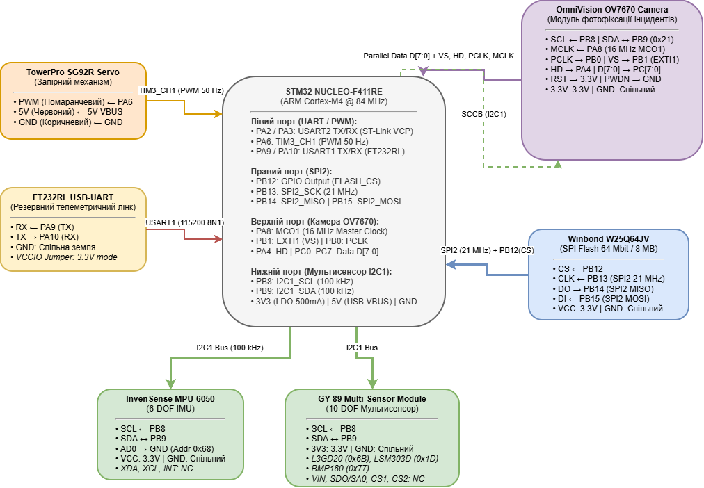

# Специфікація підключення та апаратна розпіновка (Pinout Specification)
## Мультирежимний реєстратор інцидентів (Incident Recorder: Black Box)
**Платформа:** STM32 NUCLEO-F411RE (MCU STM32F411RET6, LQFP64)
**Автори:** Команда розробки (відповідальний: Владислав Сухомлін)

---

## 1. Зведена таблиця підключення периферії (Master Pinout Table)

| Пін МК | Номер AF | Периферійний блок і сигнал | Роз'єм Nucleo (Morpho / Arduino) | Пристрій / Модуль | Пін пристрою | Рівень напруги (5V tolerant) | Наявність Pull-up / Pull-down | Обґрунтування вибору та джерело в документації |
| :--- | :--- | :--- | :--- | :--- | :--- | :--- | :--- | :--- |
| **PA2** | AF7 | USART2_TX | CN10-35 / D1 | ST-LINK VCP | RXD | 3.3 В (FT) | Немає (Push-Pull) | Апаратне підключення до віртуального COM-порту ST-Link через перемичку SB13 *(UM1724, с. 26; DS10314, Table 8; RM0383, Table 1, с. 39)* |
| **PA3** | AF7 | USART2_RX | CN10-37 / D0 | ST-LINK VCP | TXD | 3.3 В (FT) | Немає (Float) | Апаратне підключення до ST-Link VCP через перемичку SB14 *(UM1724, с. 26; DS10314, Table 8; RM0383, Table 1, с. 39)* |
| **PA5** | - | GPIO_Output | CN10-11 / D13 | Nucleo Onboard | Green LED (LD2) | 3.3 В (FT) | Немає | Бортовий світлодіод індикації статусів системи (Active HIGH) *(UM1724, Section 7.6, с. 24; RM0383, Section 8.3.10, с. 154)* |
| **PA6** | AF2 | TIM3_CH1 | CN10-13 / D12 | SG92R Servo | PWM (Orange) | 3.3 В логіка (FT) | Внутрішній Pull-down | Апаратний ШІМ 50 Гц для керування кутом засува блокування *(DS10314, Table 8, с. 46; RM0383, Section 13.3.9, с. 333)* |
| **PA8** | AF0 | MCO1 (XCLK) | CN10-23 / D7 | OV7670 Camera | XCLK | 3.3 В (FT) | Немає (Push-Pull, High Speed) | Генерація опорного такту 16 МГц безпосередньо з HSI без завантаження CPU *(DS10314, Table 8, с. 46; RM0383, Section 6.2.10, с. 100)* |
| **PA4** | - | GPIO_Input | CN7-32 / A2 | OV7670 Camera | HREF | 3.3 В (STD) | Внутрішній Pull-down | Строб активного рядка відеокадру *(OV7670 DS, Table 1, с. 4; RM0383, Section 8.3.9, с. 153)* |
| **PB0** | - | GPIO_Input | CN7-34 / A3 | OV7670 Camera | PCLK | 3.3 В (FT) | Внутрішній Pull-down | Піксельний строб тактування паралельних даних *(OV7670 DS, Table 1, с. 4; RM0383, Section 8.3.9, с. 153)* |
| **PB1** | - | GPIO_Input (EXTI1) | CN10-24 | OV7670 Camera | VSYNC | 3.3 В (FT) | Внутрішній Pull-down | Кадровий синхроімпульс для детекції початку кадру по перериванню EXTI1 *(OV7670 DS, Table 1, с. 4; RM0383, Section 10.2.5, с. 208)* |
| **PB8** | AF4 | I2C1_SCL | CN10-3 / D15 | MPU-6050, GY-89, OV7670 | SCL / SIO_C | 3.3 В (FT) | Зовнішній 4.7 кОм на модулях + Open-Drain | Спільна тактова лінія I2C1 (100 кГц) для мультисенсорної шини *(UM1724, с. 44; DS10314, Table 8, с. 47; RM0383, Section 18.3, с. 471)* |
| **PB9** | AF4 | I2C1_SDA | CN10-5 / D14 | MPU-6050, GY-89, OV7670 | SDA / SIO_D | 3.3 В (FT) | Зовнішній 4.7 кОм на модулях + Open-Drain | Спільна лінія даних I2C1 та конфігурації камери SCCB *(UM1724, с. 44; DS10314, Table 8, с. 47; RM0383, Section 18.3, с. 471)* |
| **PB12** | - | GPIO_Output | CN10-16 | W25Q64JV Flash | CS# | 3.3 В (FT) | Програмний Pull-up | Програмне керування вибором кристала SPI Flash *(W25Q64JV DS, Section 4.1, с. 9; RM0383, Section 8.3.10, с. 154)* |
| **PB13** | AF5 | SPI2_SCK | CN10-30 | W25Q64JV Flash | CLK | 3.3 В (FT) | Немає (Push-Pull, 21 МГц) | Апаратне тактування швидкісного інтерфейсу SPI2 *(DS10314, Table 8, с. 47; W25Q64JV DS, с. 9; RM0383, Section 20.3.3, с. 564)* |
| **PB14** | AF5 | SPI2_MISO | CN10-28 | W25Q64JV Flash | DO (IO1) | 3.3 В (FT) | Немає (Float) | Лінія читання даних із Flash-пам'яті *(DS10314, Table 8, с. 47; W25Q64JV DS, с. 9; RM0383, Section 20.3.3, с. 564)* |
| **PB15** | AF5 | SPI2_MOSI | CN10-26 | W25Q64JV Flash | DI (IO0) | 3.3 В (FT) | Немає (Push-Pull) | Лінія відправки команд та запису сторінок *(DS10314, Table 8, с. 47; W25Q64JV DS, с. 9; RM0383, Section 20.3.3, с. 564)* |
| **PA9** | AF7 | USART1_TX | CN10-21 / D8 | FT232RL | RXD | 3.3 В (FT) | Немає (Push-Pull) | Резервний апаратний канал швидкісного зливу дампу чорної скриньки *(DS10314, Table 8, с. 46; RM0383, Section 19.3.2, с. 507)* |
| **PA10** | AF7 | USART1_RX | CN10-33 / D2 | FT232RL | TXD | 3.3 В (FT) | Немає (Float) | Резервний прийом команд конфігурації CLI *(DS10314, Table 8, с. 46; DS_FT232R, с. 8; RM0383, Section 19.3.3, с. 510)* |
| **PC0** | - | GPIO_Input | CN7-38 / A5 | OV7670 Camera | D0 | 3.3 В (STD) | Float / Pull-down | Молодший біт паралельної шини пікселів *(OV7670 DS, с. 4; DS10314, Table 8; RM0383, Section 8.4.5, с. 160)* |
| **PC1** | - | GPIO_Input | CN7-36 / A4 | OV7670 Camera | D1 | 3.3 В (STD) | Float / Pull-down | Біт 1 паралельної шини пікселів *(OV7670 DS, с. 4; DS10314, Table 8; RM0383, Section 8.4.5, с. 160)* |
| **PC2** | - | GPIO_Input | CN7-35 | OV7670 Camera | D2 | 3.3 В (STD) | Float / Pull-down | Біт 2 паралельної шини пікселів *(OV7670 DS, с. 4; DS10314, Table 8; RM0383, Section 8.4.5, с. 160)* |
| **PC3** | - | GPIO_Input | CN7-37 | OV7670 Camera | D3 | 3.3 В (STD) | Float / Pull-down | Біт 3 паралельної шини пікселів *(OV7670 DS, с. 4; DS10314, Table 8; RM0383, Section 8.4.5, с. 160)* |
| **PC4** | - | GPIO_Input | CN10-34 | OV7670 Camera | D4 | 3.3 В (STD) | Float / Pull-down | Біт 4 паралельної шини пікселів *(OV7670 DS, с. 4; DS10314, Table 8; RM0383, Section 8.4.5, с. 160)* |
| **PC5** | - | GPIO_Input | CN10-6 | OV7670 Camera | D5 | 3.3 В (STD) | Float / Pull-down | Біт 5 паралельної шини пікселів *(OV7670 DS, с. 4; DS10314, Table 8; RM0383, Section 8.4.5, с. 160)* |
| **PC6** | - | GPIO_Input | CN10-4 | OV7670 Camera | D6 | 3.3 В (FT) | Float / Pull-down | Біт 6 паралельної шини пікселів *(OV7670 DS, с. 4; DS10314, Table 8; RM0383, Section 8.4.5, с. 160)* |
| **PC7** | - | GPIO_Input | CN10-19 / D9 | OV7670 Camera | D7 | 3.3 В (FT) | Float / Pull-down | Старший біт паралельної шини даних. Вибір порту PC0–PC7 забезпечує атомарне зчитування байта виразом `(GPIOC->IDR & 0xFF)` за 1 такт CPU *(DS10314, Table 8, с. 48; RM0383, Section 8.4.5, с. 160)* |
| **PC13** | - | GPIO_Input (EXTI13) | CN7-23 | Nucleo Onboard | Blue Button (B1) | 3.3 В (FT) | Зовнішній 100 кОм Pull-up | Апаратна кнопка користувача для ручного тестування тригерів та скидання аварій *(UM1724, Section 7.7, с. 24; RM0383, Section 10.2.5, с. 208)* |

---

## 2. Карта адрес шин та регістрів ідентифікації

| Інтерфейс | Пристрій / Чіп | 7-бітна адреса шини / Команда | Байт Read / Write | Регістр ідентифікації (ID Register) | Очікуване значення ID | Призначення пристрою в системі |
| :--- | :--- | :--- | :--- | :--- | :--- | :--- |
| **I2C1** | **MPU-6050** | `0x68` (AD0 = GND) | `0xD1` / `0xD0` | `WHO_AM_I` (`0x75`) | `0x68` | Головний 6-осьовий IMU для фіксації ударів і перекидання *(RM-MPU-6000A, с. 46)* |
| **I2C1** | **L3GD20** (GY-89) | `0x6B` (SDO = VDD) | `0xD7` / `0xD6` | `WHO_AM_I` (`0x0F`) | `0xD4` | Прецизійний 3-осьовий гіроскоп кутової швидкості *(DocID022116, с. 31)* |
| **I2C1** | **LSM303D** (GY-89) | `0x1D` (SDO = VDD) | `0x3B` / `0x3A` | `WHO_AM_I` (`0x0F`) | `0x49` | 3-осьовий акселерометр + магнітометр орієнтації *(DocID023312, с. 31)* |
| **I2C1** | **BMP180** (GY-89) | `0x77` (Фіксована) | `0xEF` / `0xEE` | `id` (`0xD0`) | `0x55` | Барометричний датчик тиску та висоти вантажу *(BST-BMP180, с. 18)* |
| **I2C1 (SCCB)**| **OV7670** | `0x21` (`0x42`/`0x43`) | `0x43` / `0x42` | `PID` (`0x0A`), `VER` (`0x0B`) | `0x76`, `0x70` | Керування параметрами камери фотофіксації інциденту *(OV7670 DS, с. 11)* |
| **SPI2** | **W25Q64JV** | Команда `0x9F` | - | `JEDEC ID` (3 байти) | `0xEF 0x40 0x17` | Енергонезалежне сховище журналу інцидентів та знімків *(W25Q64JV DS, с. 49)* |

---

## 3. Розрахунок параметрів тактування шин (Clock Tree Calculation)

* **Первинне тактування:** Внутрішній високостабільний RC-генератор HSI = 16 МГц *(RM0383, Section 6.2.2, с. 97)*.
* **Головний помножувач PLL (RM0383, Section 6.2.3, с. 97; Section 6.3.2, с. 105):**
  $$\text{VCO}_{\text{IN}} = \frac{\text{HSI}}{\text{PLLM}} = \frac{16\text{ МГц}}{16} = 1.0\text{ МГц}$$
  $$\text{VCO}_{\text{OUT}} = \text{VCO}_{\text{IN}} \times \text{PLLN} = 1.0\text{ МГц} \times 336 = 336\text{ МГц}$$
  $$\text{SYSCLK} = \frac{\text{VCO}_{\text{OUT}}}{\text{PLLP}} = \frac{336\text{ МГц}}{4} = \mathbf{84\text{ МГц}}$$
* **Шина AHB (HCLK):** Prescaler = 1 $\rightarrow$ **84 МГц** (тактування ядра Cortex-M4 і портів GPIO, RM0383, с. 109).
* **Шина APB1 (PCLK1, Low Speed Peripheral):**
  * Prescaler = 2 $\rightarrow$ $f_{\text{APB1}} = \frac{84}{2} = \mathbf{42\text{ МГц}}$ (максимум для STM32F411 — 50 МГц, RM0383, с. 108).
  * Тактування таймерів APB1 (TIM3): оскільки подільник APB1 $\neq 1$, частота множиться на 2 $\rightarrow$ $f_{\text{TIMCLK}} = 42\text{ МГц} \times 2 = \mathbf{84\text{ МГц}}$ *(RM0383, Section 6.2, с. 95; Section 6.3.21, с. 136)*.
* **Шина APB2 (PCLK2, High Speed Peripheral):**
  * Prescaler = 1 $\rightarrow$ $f_{\text{APB2}} = \mathbf{84\text{ МГц}}$ (тактування USART1, RM0383, с. 108).

### Розрахунок інтерфейсів:
1. **Шина I2C1 (Standard Mode 100 кГц, RM0383, Section 18.6.8, с. 499):**
   * Період шини: $T = 10\text{ мкс}$, півперіод $T_{\text{high}} = T_{\text{low}} = 5\text{ мкс}$.
   * Значення регістра `CCR`:
     $$\text{CCR} = \frac{T_{\text{high}}}{T_{\text{PCLK1}}} = \frac{5\text{ мкс}}{\frac{1}{42\text{ МГц}}} = 5\text{ мкс} \times 42\text{ МГц} = \mathbf{210} \quad (\text{0x00D2})$$
   * Значення регістра `TRISE` (максимальний час наростання 1000 нс, RM0383, Section 18.6.9, с. 500):
     $$\text{TRISE} = (1000\text{ нс} \times 42\text{ МГц}) + 1 = 42 + 1 = \mathbf{43}$$
2. **Шина SPI2 (Winbond W25Q64JV, RM0383, Section 20.5.1, с. 598):**
   * Джерело тактування: APB1 (42 МГц).
   * Подільник `SPI_BAUDRATEPRESCALER_2` (біти BR[2:0] = 000): $f_{\text{SCK}} = \frac{42\text{ МГц}}{2} = \mathbf{21\text{ МГц}}$ (відповідає ліміту W25Q64 до 133 МГц і забезпечує надійність сигналу на макетній платі).
3. **ШІМ-таймер сервоприводу TIM3 CH1 (SG92R, RM0383, Section 13.4.11–12, с. 364):**
   * Опорна частота таймера: 84 МГц.
   * Подільник переддільника `PSC = 83`:
     $$f_{\text{CNT}} = \frac{84\text{ МГц}}{83 + 1} = 1.0\text{ МГц} \quad (\text{крок лічильника } 1.0\text{ мкс})$$
   * Період переповнення `ARR = 19999`:
     $$T_{\text{PWM}} = (19999 + 1) \times 1.0\text{ мкс} = 20000\text{ мкс} = \mathbf{20.0\text{ мс} \quad (50\text{ Гц})}$$
   * Керування кутом (тривалість імпульсу CCR1):
     * `CCR1 = 1000` (1.0 мс $\rightarrow$ 0°, засув розблоковано)
     * `CCR1 = 1500` (1.5 мс $\rightarrow$ 90°, проміжний стан)
     * `CCR1 = 2000` (2.0 мс $\rightarrow$ 180°, засув заблоковано / опломбовано)
4. **Тактування камери XCLK (PA8 MCO1, RM0383, Section 6.2.10, с. 100):**
   * Вихідний сигнал MCO1 налаштовано напряму від джерела HSI (Prescaler = 1, біти MCO1[1:0]=00, MCO1PRE[2:0]=000) $\rightarrow$ стабільна меандрова частота **16 МГц**, що строго входить у робочий діапазон камери OV7670 (10–48 МГц).

---

## 4. Бюджет струму та живлення (Power Budget)

* **Допустиме навантаження лінії 3.3 В плати Nucleo:** Вбудований лінійний стабілізатор LDO ST1L05PU33R забезпечує максимальний вихідний струм до **500 мА** *(UM1724, Section 7.5.4, с. 23)*.
* **Розрахунок споживання лінії 3.3 В у найгіршому випадку (Worst-Case Peak):**
  * MCU STM32F411RE (@84 МГц, активна периферія): 25.0 мА *(DS10314, с. 72)*
  * MPU-6050 (Active, гіроскоп + акселерометр): 3.9 мА *(PS-MPU-6000A, с. 14)*
  * GY-89 (L3GD20: 6.1 мА + LSM303D: 0.3 мА + BMP180: 0.03 мА): 6.43 мА *(DocID022116; DocID023312; BST-BMP180)*
  * W25Q64JV Flash (режим циклічного стирання блоку Sector Erase): 25.0 мА *(W25Q64JV DS, с. 61)*
  * OV7670 Camera (активне захоплення пікселів): 18.0 мА *(OV7670 DS, с. 5)*
  * FT232RL (активна передача даних по UART): 15.0 мА *(DS_FT232R, с. 15)*
  * **Сумарний піковий струм на лінії 3.3 В:**
    $$I_{\text{total}} = 25.0 + 3.9 + 6.43 + 25.0 + 18.0 + 15.0 = \mathbf{93.33\text{ мА}}$$
  * **Коефіцієнт запасу:** $\frac{500\text{ мА}}{93.33\text{ мА}} \approx \mathbf{5.35}$ (лінія навантажена лише на 18.6% від номіналу).

* **Живлення силового навантаження (Сервопривід SG92R):**
  * Струм холостого ходу сервоприводу: 100–250 мА, піковий струм рушання з місця / блокування ротора: **до 500 мА** *(SG92R DS, с. 1)*.
  * **Рішення:** Підключення сервоприводу до лінії 3.3 В **суворо заборонено**, оскільки імпульсне просідання викликало б перезавантаження MCU через вбудований детектор Brown-Out Reset (BOR, RM0383, Section 5.2.2, с. 74). Сервопривід живиться безпосередньо від піна **5V (USB VBUS)**, а земля живлення є спільною з GND мікроконтролера.

---

## 5. Розділ «Відхилені варіанти» (Rejected Design Alternatives)

Відповідно до вимог п. 4.1 методичних вказівок, наведено детальний інженерний аналіз альтернативних схемотехнічних рішень, які розглядалися на етапі проектування та були відхилені з конкретних технічних причин:

### Варіант №1: Використання пінів PB6 (SCL) та PB7 (SDA) для шини I2C1
* *Суть варіанта:* Використання первинної пари виводів I2C1, які CubeMX призначає за замовчуванням.
* *Причина відхилення:* 
  1. На платах Nucleo-64 виводи PB8 та PB9 безпосередньо підведені до стандартних конекторів Arduino D15/D14, мають чітке маркування та розпаяні поруч із шинами живлення.
  2. Вивід PB6 за замовчуванням з'єднаний із піном Arduino D10, який часто використовується іншими платами розширення як апаратний CS SPI. 
  3. Перепризначення I2C1 на PB8/PB9 звільнило нижній порт B і запобігло геометричному перехрещенню шлейфів над платою.

### Варіант №2: Організація паралельної шини камери D[7:0] на випадкових вільних пінах портів A і B
* *Суть варіанта:* Підключення ліній D0–D7 до розрізнених пінів (наприклад, PA0, PA1, PB4, PB5, PC2 тощо), доступних на роз'ємах Morpho.
* *Причина відхилення:*
  1. Оскільки MCU STM32F411RE не має апаратного периферійного блоку DCMI, зчитування кадру реалізується програмно на високій частоті такту PCLK (~8–16 МГц).
  2. При розрізнених пінах для формування одного байта пікселя процесору довелося б зчитувати кілька регістрів `IDR` (RM0383, с. 160), виконувати операції побітового зсуву (`>>`, `<<`) та накладати логічне `OR`. Це займало б не менше 15–20 машинних тактів на кожен байт, що призвело б до 100% завантаження ядра і пропуску пікселів.
  3. Виділення неперервної групи **PC0–PC7** дозволяє виконати читання всього байта за **1 машинний такт**: `uint8_t pixel_byte = (uint8_t)(GPIOC->IDR & 0xFF)`.

### Варіант №3: Генерація тактування камери XCLK через канал ШІМ таймера TIM1 (PA8) замість MCO1
* *Суть варіанта:* Налаштування піна PA8 як каналу TIM1_CH1 у режимі PWM із заповненням 50% для формування частоти 16 МГц.
* *Причина відхилення:*
  1. Робота розширеного таймера TIM1 на такій частоті вимагає додаткових обчислень дільників і блокує ресурси таймера, які можуть знадобитися для точних захватів подій.
  2. Використання спеціалізованого апаратного виводу **MCO1 (Master Clock Output 1, AF0, RM0383, Section 6.2.10, с. 100)** транслює частоту внутрішнього генератора HSI напряму на пін PA8 без залучення блоків таймерів і без споживання додаткової динамічної потужності.

---

## 6. Схема підключення стенда (Wiring Diagram)

